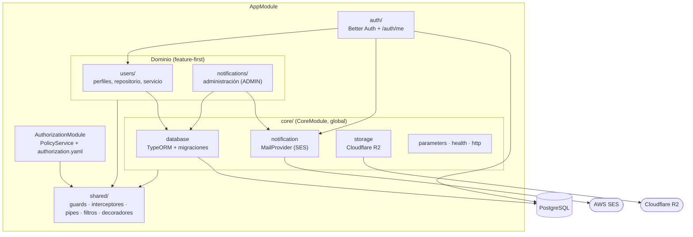
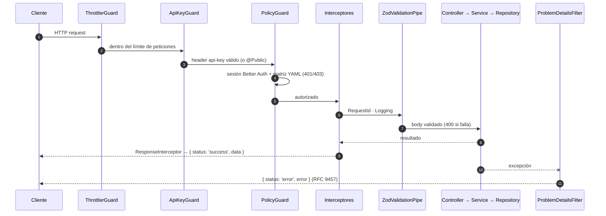

# Arquitectura y Estructura

El sistema está diseñado como un **Monolito Modular** (Modular Monolith) utilizando un enfoque en el dominio o características (*Feature First*).

## ¿Qué significa esto?

A diferencia de organizar el proyecto por el tipo de archivo (todas las entidades juntas, todos los servicios juntos, etc.), aquí organizamos el código según **la capacidad o módulo de dominio** al que pertenece. Cada carpeta principal bajo `src/` representa un subdominio específico de la aplicación.

```text
src/
├── auth/            # Configuración de Better Auth y endpoint local-auth/me
├── users/           # Perfiles de usuario (módulo de ejemplo/canónico)
├── notifications/   # Administración de notificaciones (rol ADMIN)
├── core/            # Infraestructura transversal (DB, notificaciones, storage, health...)
└── shared/          # Guards, autorización, interceptores, pipes, filtros, decoradores, utils
config/
└── authorization.yaml   # Matriz de autorización (rol → recurso → métodos HTTP)
```

## Separación de `core/` y `shared/`

Es común confundir estas dos carpetas:

* **`core/`**: Módulos de infraestructura con estado o dependencias externas que se instancian UNA VEZ. `CoreModule` es global e importa: `DatabaseModule` (TypeORM), `NotificationModule` (AWS SES, plantillas multi-idioma), `HttpModule` (cliente HTTP), `ParametersModule` (idiomas), `StorageModule` (Cloudflare R2 con presigned URLs) y `HealthModule`. También contiene la configuración (`config/`), las migraciones y los seeders. Su lugar está en `AppModule`; no lo importes desde módulos de dominio.
* **`shared/`**: Código transversal reutilizable sin lógica de dominio: guards (`PolicyGuard`, `ApiKeyGuard`), autorización (`PolicyService`, constante `ROLES`), interceptores (`RequestId`, `Logging`, `Response`), el `ZodValidationPipe`, el filtro `ProblemDetailsFilter` (RFC 9457), decoradores (`@Public`, `@AllowAnonymous`, `@OptionalAuth`, `@Transactional`, `@ApiSuccessResponse`...), interfaces (`ApiSuccess`, `ProblemDetails`, sesión extendida) y utilidades.

## Ciclo de Vida de una Petición

1. **Cliente HTTP**: realiza la petición (ejemplo: `POST /api/v1/users/profile`).
2. **`ApiKeyGuard`** (global, `main.ts`): exige el header `api-key`, salvo en rutas marcadas con `@Public()`.
3. **`PolicyGuard`** (global, `AppModule`): obtiene la sesión de Better Auth desde la cookie (una sola vez por petición) y consulta la matriz `config/authorization.yaml` según el rol(es) del usuario, el recurso y el método HTTP. Responde `401` sin sesión y `403` sin permiso. Se salta con `@AllowAnonymous()` u `@OptionalAuth()`.
4. **Interceptores** (global): `RequestIdInterceptor` genera un UUID y lo deja en `request.requestId`; `LoggingInterceptor` registra método, URL, estado y duración; `ResponseInterceptor` envuelve la respuesta en `{ status: 'success', data, requestId }`.
5. **Pipes**: `ZodValidationPipe` valida el body cuando recibe un schema (`@Body(new ZodValidationPipe(Schema))`); si falla, responde 400 con los errores de Zod.
6. **Controllers**: delegan en `UsersService`, etc., y comprueban la propiedad de recursos por `:id` cuando aplica.
7. **Services**: ejecutan la lógica de negocio; usan `@Transactional()` para escrituras multi-tabla.
8. **Repositories**: (`UserRepository`) acceden a PostgreSQL mediante TypeORM.
9. **`ProblemDetailsFilter`** (global): cualquier excepción se serializa como Problem Details (RFC 9457) dentro del envelope `{ status: 'error', error }` (`requestId` solo aparece si el cliente envía el header `x-request-id`).

Este encapsulamiento evita "controllers gigantes" y mantiene las dependencias localizadas.

## Diagramas

### Vista de módulos

Las flechas indican dependencia. Los módulos de dominio (`users`, `notifications`) dependen de `core`/`shared`, nunca al revés ni entre sí por detalles internos.



### Ciclo de vida de una petición


